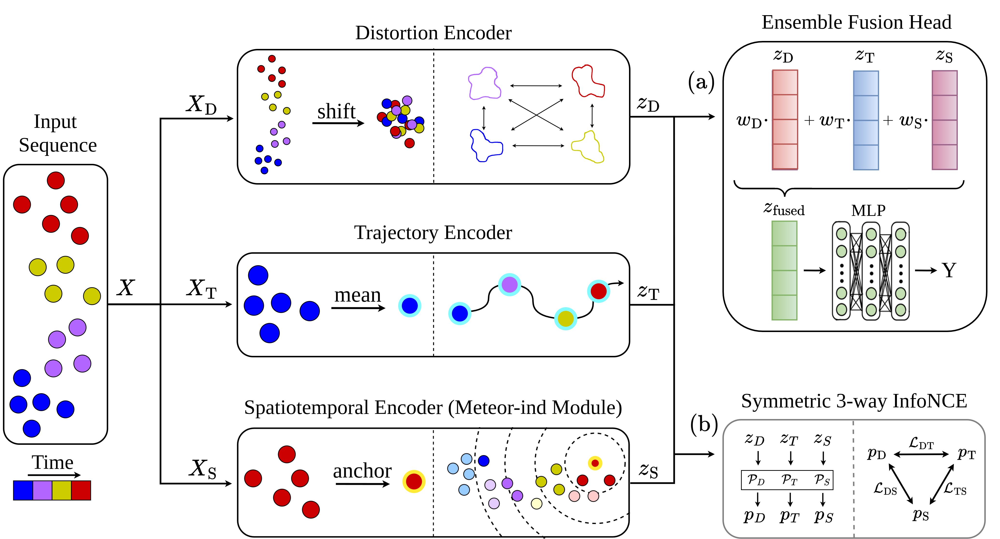

# [ChronoPoints: Trajectory-based classification of small flying objects](https://doi.org/10.1016/j.mlwa.2026.101045)





## Citation
If you find our work useful in your research, please consider citing:
```
@article{KESZLER2026101045,
    title = {ChronoPoints: Trajectory-based classification of small flying objects},
    journal = {Machine Learning with Applications},
    pages = {101045},
    year = {2026},
    issn = {2666-8270},
    doi = {https://doi.org/10.1016/j.mlwa.2026.101045},
    url = {https://www.sciencedirect.com/science/article/pii/S2666827026002100},
    author = {Anita Keszler and Krisztián Balla and András L. Majdik},
}
```

## Dataset
Download the dataset zip file from:  
https://doi.org/10.5281/zenodo.22671326

Extract it so that your folder structure looks like this:
```bash
dataset/
└── LIFT_benchmark/
```

## Benchmark Models, Attribution, and Usage
This repository includes implementations of several third-party models for benchmarking purposes. All original implementations belong to their respective authors, and links to the official repositories along with citation instructions are provided in each model's folder. We only provide adapted versions to enable consistent training and evaluation on our dataset.

As the models require different environments, a separate `Dockerfile` is provided for each of them. **To train and evaluate both the comparison models and our own model, please refer to the README files in the respective folders.**

## Dependencies

The project has been tested on **Ubuntu 22.04** with the following GPUs:
- NVIDIA GeForce GTX 1080 Ti  
- NVIDIA GeForce RTX 3080 Ti  

(Though you'll have to manually compile custom TensorFlow GPU ops against newer video cards that are not compatible with CUDA 9 to use MeteorNet (see the README in the MeteorNet folder). For CUDA 9 we provide them already compiled.)
### Docker

Docker is required to run the project. Install it by following the official guide:

👉 https://docs.docker.com/engine/install/ubuntu/

Use the **APT repository installation method**.

After installation, run the following commands to avoid having to use `sudo` with the docker cli:

```bash
sudo groupadd docker
sudo usermod -aG docker $USER
```
This adds your user to the `docker` group, allowing you to execute Docker commands without elevated privileges.

### NVIDIA Container Toolkit (GPU Support)
To enable GPU acceleration inside Docker containers, install the NVIDIA Container Toolkit:

👉 https://docs.nvidia.com/datacenter/cloud-native/container-toolkit/latest/install-guide.html

Follow the **APT repository setup** instructions, and be sure to complete the **“Configuring Docker”** section to properly enable GPU support.
